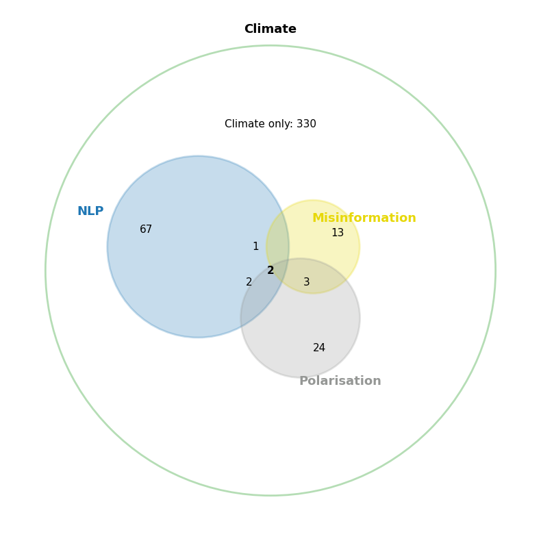
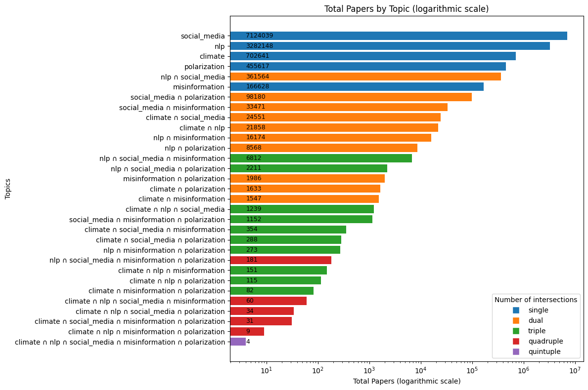
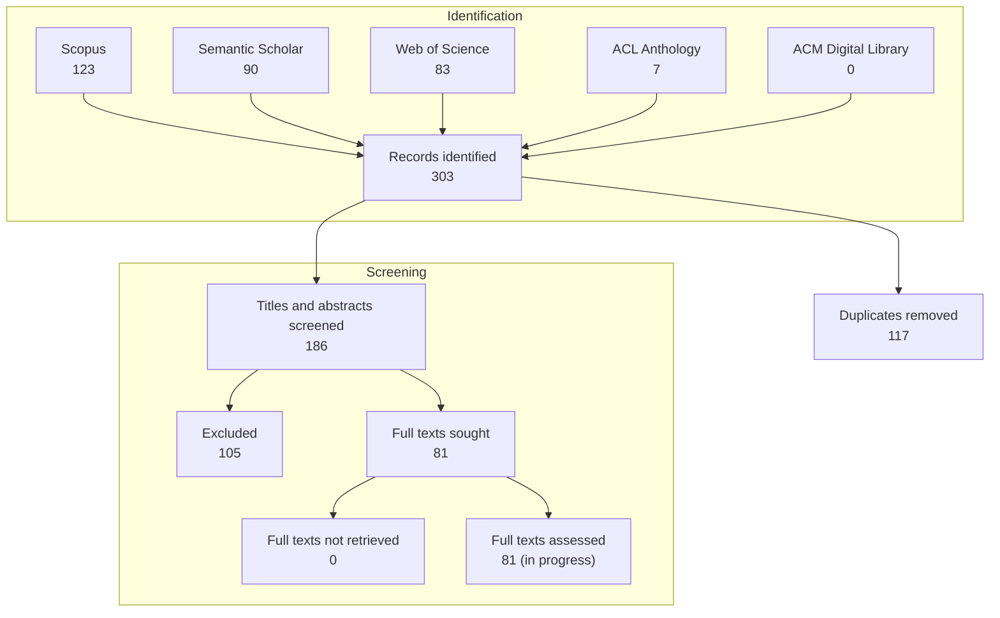

# Systematic literature review: NLP for climate misinformation and polarization on social media

A project by the Computational Linguistics group (GroNLP) and the Research Centre for Media and Journalism Studies of the University of Groningen.

## Summary

This repository supports a systematic literature review (SLR) of studies that use **natural language processing** (NLP) and other AI methods to study **climate misinformation** and **polarization** on
**social media**. 

This SLR captures aspects of scientific publications that are somewhat overlooked in surveys in the field of computer science. That is, it goes beyond listing available datasets and model performance. It also intends to capture whether each paper builds on a theoretical framework (e.g., a definition or typology of misinformation or polarization) and uses methods that match it. It records whether the paper draws conclusions about climate, misinformation or polarization rather than only about its machine learning models, and whether the paper examines the link (association or causation) between misinformation and polarization. It asks if the methods proposed are actionable and involve stakeholders. Additionaly it reports the role of LLMs and other models in annotating data and stablishing what is consider the ground truth in the misinformation setting. 

We searched five databases (Scopus, Web of Science, Semantic Scholar, the ACL Anthology and the ACM
Digital Library) for papers published between January 2010 and April 2026 that match the query

> **climate** AND **NLP** AND **social media** AND (**misinformation** OR **polarization**)

where each topic stands for a set of keywords searched in titles and abstracts. The search returned
303 records, which became **186** unique papers after removing duplicates. Three annotators screened
titles and abstracts in two rounds, on samples of 50 and 20 papers. After each round they refined the
inclusion criteria, and in the second round they reached an agreement of 0.93 (Krippendorff's alpha).
A single annotator then screened the remaining 116 papers. **81** papers were selected for the
full-text assessment, for which a questionnaire of **68 questions** and its respective web application were created. The full-text assessment phase is currently on going. 

---

## Contents

1. [Motivations](#1-motivations)
2. [Progress at a glance](#2-progress-at-a-glance)
3. [Step 1: Literature search](#3-step-1-literature-search)
4. [Step 2: Merging and removing duplicates](#4-step-2-merging-and-removing-duplicates)
5. [Step 3: Title and abstract screening](#5-step-3-title-and-abstract-screening)
6. [Step 4: Retrieving the full texts](#6-step-4-retrieving-the-full-texts)
7. [Step 5: Full-text assessment (in progress)](#7-step-5-full-text-assessment-in-progress)
8. [Repository map](#8-repository-map)

---

## 1. Motivations

This systematic literature review is the first phase of the project **DeCODA-LM: Depolarizing Climate Online Discourse with Argumentative Language Models**, which aims to use Natural Language Processing (NLP) to examine the argumentative structures underlying climate misinformation online. The project investigates how these structures contribute to polarization in digital conversations, and works toward developing automated corrections that include, beyond factual accuracy and proper logic, rhetorical mechanisms to better adapt to the audience. 

One of the central research questions the DeCODA-LM project aims to answer is to what extent climate misinformation spread on social media influence political polarization in environmental discussions. This systematic literature review is intends to understand the current state of research on this topic, and to identify gaps in the literature. 

**Small intersections**
We hypothesized that the papers that jointly analyse climate misinformation and polarization on social media using NLP methods are scarce. Our first exploratory searches supported this idea: 
- In the journal *WIREs Climate Change*, we looked at articles of type *Advanced Review* or *Systematic Review* that mention climate. Of **442** such reviews, 72 mention NLP or AI terms, 19 mention misinformation and 31 mention polarization. Only **2** combine NLP, misinformation and polarization. The pairwise overlaps are also small: NLP and misinformation 3, NLP and polarization 4, misinformation and polarization 5. (See figure below.)

    

- The large literature databases show the same pattern. The chart and image below we show the number of papers found for each topic in Semantic Scholar and the ACL anthology. For instance, notice that althought there are millions of papers related to social media or NLP, and thousands about climate, polarization or misinformation (blue bars in the chart), only 4 papers combine all five topics (purple bar in the chart). 

(publication from January 2010 to April 2026):

| Papers mentioning… | Semantic Scholar | ACL Anthology |
|---|---:|---:|
| climate | 702,641 | 115 |
| climate + NLP/AI | 21,858 | 86 |
| climate + NLP/AI + social media | 1,239 | 28 |
| climate + NLP/AI + social media + misinformation | 60 | 7 |
| climate + NLP/AI + social media + polarization | 34 | 0 |
| climate + NLP/AI + misinformation + polarization | 9 | 2 |
| all five topics together | 4 | 0 |

These counts were downloaded in
[notebooks/01_data_collection.ipynb](notebooks/01_data_collection.ipynb).

    

Given that also the intersection of misinformation and polarization is small, another motivation for this study is to examine the link between misinformation and polarization, that is for instance, to inspect if there is evidence of association or causation between these two phenomena in the context of climate online discourse.    

**The roll of the computer science community**
It is not rare to find share tasks and competitions in computer science that focus on misinformation or polarization. For instance, [CLEF CheckThat! 2026](https://checkthat.gitlab.io/clef2027/) involved a task on fact checking; [ClimateCheck 2026](https://aclanthology.org/2026.nslp-1.7/) focused on scientific fact-checking of climate-related claims and disinformation narrative classification; [Touché at CLEF 2026](https://touche.webis.de/clef26/touche26-web/fallacy-detection.html), [MM-ArgFallacy2025](https://aclanthology.org/2025.argmining-1.35/), and [FadeIT at EVALITA 2026](https://aclanthology.org/2026.evalita-1.62/) addressed fallacy detection, [SemEval-2026 Task 9](https://aclanthology.org/2026.semeval-1.453/) focused on online polarization detection, just to mention a few competitions from the last couple of years. However, we noticed that some articles use online climate, misinformation or polarization as their context to test machine learning models, later model performance takes the spotlight of the discussion, and the actual phenomena (misinformation or polarization) are not analysed in depth. Therefore, in this systematic literature review we aim to understand whether the computational research community is producing meaningful insights about climate misinformation and polarization.     

**Stakeholders and actionability** 
While the previous motivation addressed the possible pitfalls of the computer science community, this one challenges the academic community as a whole. More specifically. how we interact with stakeholders and whether our research is actionable, where actionability refers to the degree to which the method proposed enables decision-making or intervention [(Delobelle et al., 2024)](https://aclanthology.org/2024.emnlp-main.1207/). We want to investigate whether stakeholders such as fact-checkers or policy makers are involved when computational tools and datasets are developed, and whether those tools are developed with actionability in mind.

**Theoretical alignment and methods. Are we all on the same page?**
Given that the DeCODA-LM project inhabits different research communities (e.g., computer science, media studies, enviromental science) we aim to understand whether the different communities are using the same definitions and typologies of misinformation and polarization, or in fact if they use any theoretical framework at all to define these constructs. Furthermore, we would like know to whether the methods used actually match the constructs they claim to measure.

**Language models and stablishing the grouth truth**
Beside the motivations above, this literature review also quantifies the traditional aspects of a survey in NLP, such as the datasets and the machine learning models used. But most importantly, we want to understand the role of language models in the annotation of data, and how truth is established in the context of climate misinformation. 

---

## 2. Progress at a glance

The review follows the PRISMA reporting guidelines. The diagram below shows the flow of papers so far.

| Step | Status |
|---|---|
| 1. Literature search in five databases | Done |
| 2. Merging and removing duplicates | Done |
| 3. Title and abstract screening | Done: 81 of 186 papers included |
| 4. Retrieving full texts | Done: all 81 PDFs found |
| 5. Full-text assessment | In progress |

---

## 3. Step 1: Literature search

Notebook [notebooks/01_data_collection.ipynb](notebooks/01_data_collection.ipynb) contains the details about the collection of papers from the five databases. 

### The query

We grouped search terms into five topics and searched for papers that match all of the following:

> **climate** AND **NLP/AI** AND **social media** AND (**misinformation** OR **polarization**)

Terms were searched in titles and abstracts (and keywords where the database supports it). The search
covers papers published between **1 January 2010 and 30 April 2026**. The full keyword list is in
[data/search_query/keywords.yml](data/search_query/keywords.yml), and the date range is in
[config.yml](config.yml). Some examples from each group (`*` matches any word ending, e.g. `LLM*` also finds
"LLMs"):

| Topic | Example keywords |
|---|---|
| Climate | global warming, climate change, climate science, climate denial, climate crisis, climate skepticism, climate action, climate misinformation |
| NLP / AI | natural language processing, NLP, machine learning, LLM\*, AI, artificial intelligence, language model(s), neural network(s), Generative AI, text mining, text classification, deep learning, transformer\*, argument mining, sentiment analysis |
| Social media | social media, social network(s), online communities, alternative platforms, alt-tech, plus about 30 platform names (YouTube, TikTok, Facebook, Instagram, Telegram, WhatsApp, Reddit, Twitter/X, Bluesky, Mastodon, 4chan, Gab, Truth Social, …), tweet(s), user comment(s) |
| Misinformation | misinform\*, disinform\*, fake news, conspiracy theory/theories, debunking, claim verification, deception, hoax\*, fallac\*, rumor\*, propaganda |
| Polarization | polarization, polarisation, echo chamber, hyperpartisan\*, homophily |

### How each database was searched

Different collection methods were use for the different databases. 
Some were collected through the database's API while others were collected semi-manually, *i.e.,* we automatically generate the query based on our keywords and manually input in the search on the database website and exported the results.

| Database | How the papers were collected | Papers found |
|---|---|---:|
| **Scopus** | Automatic, through the Scopus API (run from the university network). | 123 |
| **Semantic Scholar** | Automatic, through the public Semantic Scholar API. Very large result sets stop downloading partway without an error, so these were downloaded one publication year at a time. | 90 |
| **Web of Science** | Semi-manual. Our access to the Web of Science API does not include abstracts, so we used the *Advanced Search* on the website (exact search on the *Topic* field) and exported the full records. | 83 |
| **ACL Anthology** (the main NLP venue archive) | Automatic. We downloaded the full Anthology catalogue and matched the keywords against titles and abstracts ourselves. | 7 |
| **ACM Digital Library** | Semi-manual. *Advanced Search* on the website (through the university library), searching titles and abstracts. | 0 |

ACM returned no papers for the main query, and none when misinformation or polarization was added separately. Even the broader combination of climate, NLP and social media returned only 2 papers.

Differences between the databases that affect the results:

- **Upper and lower case.** Most databases ignore capitalisation, so the platform *Signal* cannot be told apart from the ordinary word *signal*. This brings in some irrelevant papers (e.g. from signal processing), which were removed at screening. The ACL Anthology search was the only one where we could tell them apart.
- **Wildcards** (`*`) behave differently in each database. For example, Semantic Scholar only applies them to single words, and Web of Science and ACM do not apply them inside quoted phrases. We adjusted the query for each database.
- **Dates.** The ACL Anthology only records the year of publication, so for that source the date filter works by year.

Besides the main query, the notebook also counts every combination of the five topics in Semantic Scholar and the ACL Anthology. These counts are the ones in the [Introduction](#1-introduction) table.

---

## 4. Step 2: Merging and removing duplicates

Notebook: [notebooks/02_data_merge.ipynb](notebooks/02_data_merge.ipynb) documents the process to merge the results from the different sources and remove duplicates. 

The same paper often appears in several databases. We combined the 303 records and matched duplicates in four stages:

1. Same **DOI** (the permanent identifier of a publication).
2. Same **ACL Anthology ID**.
3. Same **arXiv ID** (the identifier of the preprint server arXiv).
4. Practically **identical title** with a publication year at most one year apart, to catch papers
   that lack shared identifiers.

This left **186 unique papers**: 111 were found in only one database, 35 in two, 38 in three and 2 in all four. The merged list is stored in [data/processed/merged_minimal.jsonl](data/processed/merged_minimal.jsonl). The same notebook also drew the random samples used to measure agreement between annotators (see Step 3) and prepared the screening spreadsheets.

---

## 5. Step 3: Title and abstract screening

### Inclusion criteria

To define which papers to include in the full-text assessment, we set up a screening process based on the title and abstract of each paper and other metadata. A paper is included only if it meets **all** of the following criteria ([documents/screening_filtering_criteria](documents/screening_filtering_criteria)):

1. It must be written in **English**.
2. It must have been published in a **peer-reviewed** journal or conference proceedings only.
3. It must be a "regular" research paper, survey paper, position paper or demo paper. (Exclude books,
   book chapters, theses, technical reports, magazines, standards and preprints.)
4. It must address **climate** change, global warming, climate denial, or closely related
   environmental phenomena (e.g., energy transition, climate action) **as a primary or substantial
   topic**. Such topics can be the main topic or one of the main topics (e.g., a study focuses on
   climate and political data).
5. It must employ at least one **computational, NLP, or AI-based** method as part of its methodology.
6. It must substantially address **at least one of the following**: (a) **misinformation**,
   disinformation, fake news, or conspiracy theories; **OR** (b) **polarization**, echo chambers, or
   related phenomena of opinion divergence. Such topics can be mentioned explicitly or implicitly
   (e.g., a data analysis that describes a way of measuring polarization, but it does not state the
   word "polarization").
7. It must **either** (a) **use data from at least one social media platform** as the primary
   empirical basis, **OR** (b) **substantially address social media as the primary context** of study
   (e.g. survey papers, literature reviews, or theoretical frameworks explicitly focused on social
   media).

### Agreement between annotators

3 annotators screened the papers following the inclusion criteria above. To ensure that the criteria were applied consistently, we measured the agreement between annotators in two rounds. Notebook [notebooks/03_iaa_analysis.ipynb](notebooks/03_iaa_analysis.ipynb) documents this process. 

Agreement was measured with **Cohen's kappa** (for pairs of annotators) and **Krippendorff's alpha** (for all three together). Both scores go from 0 (agreement no better than chance) to 1 (perfect agreement).

| Round | Papers | Design | Cohen's kappa | Krippendorff's alpha |
|---|---:|---|---|---:|
| Round 1 | 50 | 20 papers read by all three, plus 10 per pair of annotators | 0.34 – 0.38 (fair) | 0.45 |
| Round 2 | 20 | New papers, all read by all three | 0.90 – 1.00 (almost perfect) | 0.93 |

Agreement in round 1 was low, so the annotators discussed the criteria and their disagreements before round 2, which used a new set of papers. Agreement in round 2 was high, so the remaining **116 papers** were screened by a single annotator.

### Consolidated result

Notebook [notebooks/04_screening_consolidation.ipynb](notebooks/04_screening_consolidation.ipynb) combines the three screening phases into one final decision per paper. In the two agreement rounds, papers on which annotators disagreed were settled through discussion. A few decisions were corrected later, for example for papers that turned out not to be peer-reviewed. 

| Phase | Papers screened | Included |
|---|---:|---:|
| Round 1 | 50 | 23 |
| Round 2 | 20 | 10 |
| Remaining papers | 116 | 48 |
| **Total** | **186** | **81 (44%)** |

Research area of the 81 included papers: **Misinformation** 33 (41%), **Polarization** 30 (37%),
**Both** 18 (22%).

Results: [data/processed/screening/screening_consolidated.xlsx](data/processed/screening/screening_consolidated.xlsx).
The individual annotation sheets are in [data/processed/iaa/](data/processed/iaa/) and
[data/processed/screening/](data/processed/screening/).

---

## 6. Step 4: Retrieving the full texts

In notebook [notebooks/05_pdf_retrieval.ipynb](notebooks/05_pdf_retrieval.ipynb) we automatically gathered the full texts of the 81 included papers with the reference manager **Zotero**. First, the papers' identifiers (DOI or arXiv ID) were imported into Zotero in bulk, and Zotero downloaded every PDF it could find, including those available through the university's subscriptions. The remaining papers were then looked up and saved by hand. During this step we also:

- replaced preprint versions with the published versions;
- confirmed that the papers available only through arXiv had in fact been peer-reviewed;
- checked that the Zotero collection matched the list of included papers exactly.

**All 81 full texts were retrieved.** The record of this step is in
[data/processed/retrieval/retrieval_tracking.xlsx](data/processed/retrieval/retrieval_tracking.xlsx).
The PDFs themselves are not stored in this repository, for copyright reasons.

---

## 7. Step 5: Full-text assessment (in progress)

Notebook: [notebooks/06_full_text_assessment_codebook.ipynb](notebooks/06_full_text_assessment_codebook.ipynb)

For the full-text assessment we developed a set of **68 questions** (a *codebook*) that is answered for each paper. The questions aim to capture aspects of papers that systematic reviews in NLP usually overlook. They go beyond listing model performance and the datasets used, and also capture:

- whether the paper builds on a **solid theoretical framework**, for example by giving a definition or a typology of the concepts it studies (such as polarization or misinformation);
- whether its **methods match** that theoretical framework;
- whether it draws **conclusions about climate, polarization or misinformation**, rather than only   reporting model performance;
- whether its methodology is **actionable** and **involves stakeholders**;
- the **role that LLMs and other machine learning models play** in annotating data and stablishing ground truth;
- whether it studies the **link between misinformation and polarization**, either as an association or as a cause; 
- in the case of misinformation, **how truth is established**.

The questions are grouped into ten sections: Exclusion, Climate, Misinformation, Polarization, the intersection of misinformation and polarization, Motivations and methodology, Stakeholders, Conclusions and findings, Data, and ML and computational methods. Many questions depend on earlier answers. For example, the follow-up questions about the definition of misinformation only appear if the paper gives one. Questions about data are answered separately for each dataset a paper uses.

- The codebook is available at [documents/full-text_assessment_questions.xlsx](documents/full-text_assessment_questions.xlsx), it includes the questions logic, type of question, and the possible labels. 
- A diagram of how the questions depend on each other:
  [codebook_graph.png](data/processed/full_text_assessment/codebook_graph.png)
  (also as an [interactive version](data/processed/full_text_assessment/codebook_graph.md))

### Annotation tool

To answer the questions we built our own annotation tool ([src/full_text_assessment/](src/full_text_assessment/)). It:

- checks that the codebook's question logic is consistent before anyone starts annotating;
- shows each paper's details (title, venue, identifiers, research area from screening) next to the
  questions, with the PDF available side by side;
- shows only the questions that apply, given the answers so far;
- lets annotators add new answer options while reading, which are then available for all papers;
- keeps track of codebook versions, so papers answered under an earlier version are flagged for review
  when a question changes;
- records how long each paper takes to assess.

The answers are saved in
[data/processed/full_text_assessment/](data/processed/full_text_assessment/) (mainly `papers.csv` and,
for dataset-level questions, `datasets.csv`). This step is ongoing.

---

## 8. Repository map

| Location | What it contains |
|---|---|
| [notebooks/](notebooks/) | The analysis for each step, numbered in order (00–06). Each notebook describes its step and shows the results. |
| [src/](src/) | The code behind the notebooks (database searches, merging, PDF retrieval, the annotation tool). |
| [data/search_query/](data/search_query/) | The search keywords. |
| [data/raw/](data/raw/) | The search results as downloaded from each database, including the topic-combination counts used in the [Introduction](#1-introduction) table. |
| [data/processed/](data/processed/) | Results of each step: the merged paper list, [annotator agreement](data/processed/iaa/), [screening](data/processed/screening/), [full-text retrieval](data/processed/retrieval/) and [full-text assessment](data/processed/full_text_assessment/). |
| [documents/](documents/) | The screening criteria and the full-text assessment codebook. |
| [tests/](tests/) | Automated checks for the annotation tool. |

The PDFs of the papers are not included in the repository, for copyright reasons.
